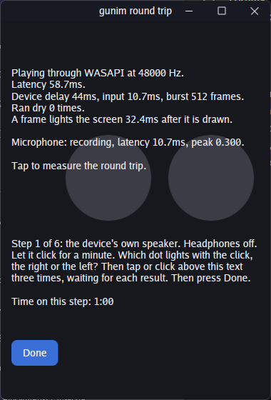
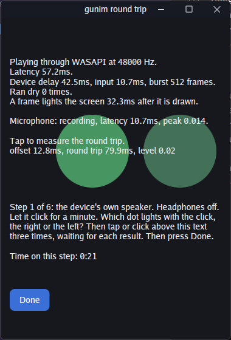

# WASAPI output check, 2026-11-03, megamachine

Issue #260. gunim's own WASAPI output, run through `example/roundtrip`.

## Machine

- MSI MPG Infinite X2 13FTD, Windows 11 Home 10.0.26300 (build 26300)
- Go 1.27.1 windows/amd64
- Commit tested: `7af17f4` (origin/master)
- Audio devices:
  - MOTU M Series (USB): Out 1-2, Out 3-4, In 1-2, In 3-4, In 5-6, Loopback, Loopback Mix.
    Out 1-2 is the default output. A mono microphone is on In 1.
  - C49RG9x monitor over NVIDIA HDMI audio. It has no speakers, so nothing on it can be heard.
  - No Bluetooth audio device.

## Summary

| Check | Result |
|---|---|
| 1. Lint and tests | Pass |
| 2. Speakers play steadily | Pass |
| 3. Switching the device mid-play | Pass for the driver. Roundtrip's click went wrong after a rate change; fixed in the commit after this one |
| 4. Bluetooth headset | Skipped: no headset |
| 5. Recording over playback | **Fail**: offset is a steady +12.8 ms, not within ±2 ms |

## 1. Lint and tests: pass

- `golangci-lint run ./...`: 0 issues ([1-lint.log](1-lint.log)).
- `go test ./audio/...`: all pass ([1-tests.log](1-tests.log)).
- `go test -v -run WASAPIPlaysOnThisMachine ./audio/speaker/` runs and passes ([1-live.log](1-live.log)):

| | |
|---|---|
| Device | Out 1-2 (MOTU M Series) |
| Rate | 48000 Hz, 2 channels |
| Period | 512 frames |
| Buffer | 1126 frames |
| LowLatency | false |
| Stream latency | 0 |
| Delay | 42.5 ms |
| Latency | 57.2 ms |
| Dropouts | 0 (235 packets) |

The input in that run was Loopback (MOTU M Series), the Windows default recording device at the time.

## 2. Speakers play steadily: pass

Ran 60 s on Out 1-2 ([2-play.log](2-play.log), [2-play.png](2-play.png)).

- The clicks were evenly spaced, with no crackle (heard on the MOTU's monitors).
- The window says "Playing through WASAPI at 48000 Hz".
- Ran dry 0 times in the whole run.
- Device delay 44 ms (44.2 at most); latency 58.7 ms.

```
speaker: WASAPI plays Out 1-2 (MOTU M Series) at 48000 Hz, 2 channels, 512 frames a period, 1126 in its buffer, 0 of stream latency, low latency false
```

The low-latency period was not used on the MOTU.



## 3. Switching the device mid-play: pass, with one fix in roundtrip

Log: [3-switch.log](3-switch.log). The retest after the fix is in [3-rate-fixed.log](3-rate-fixed.log).

1. **Default output changed to Out 3-4 and back.** It reopened on each within the same second, with no restart:
   `the default device changed ... opening the default device again` / `WASAPI plays Out 3-4 (MOTU M Series) again`, then the same for Out 1-2.
2. **MOTU's USB unplugged while default, then plugged back in.**
   - `the device's clock stood still; opening the default device again`
   - `device went away` retries over about 1 s
   - It reopened on the next default, C49RG9x (HDMI), at 48000 Hz, and the output came back about 2 s after the unplug.
   - The monitor has no speakers, so whether it played could not be heard.
   - While on HDMI, the window showed "Problem: WASAPI records nothing: the device went away". That is right: the MOTU input was gone.
   - On replug it went back to Out 1-2 and recorded from the MOTU again. No restart was needed.
3. **Out 1-2's default format changed from 48000 Hz to 44100 Hz, then back.**
   - The driver behaved as designed: `WASAPI: Out 1-2 (MOTU M Series) plays at 44100 Hz ... opening the output again` and `opened again, at 44100 Hz`. The window's rate followed, and the same happened on the way back to 48000 Hz.
   - **But the clicks played slower and lower in pitch at 44100 Hz.** The cause is in `example/roundtrip`, not the driver. The click source took `mix.Rate()` once at start and never listened to `Speaker.Changed()`. At 44100 Hz it went on making a 1 kHz click for 48000 Hz, once every 48000 frames, so the click played at 919 Hz, once every 1.09 s. The dots' timing in the view used the same stale rate.
   - The fix is the commit after the results: roundtrip plays a new click made for the new rate when `Changed()` fires, and the view reads the click playing. With the fix, the retest kept the same pitch and spacing at 44100 Hz and back at 48000 Hz, with 0 dropouts, working 41.1 ms ahead at 44100 Hz and 38.1 ms at 48000 Hz.

One more observation from the first rate change, before the fix: the reopen at 44100 Hz `ran dry 2 times in 250ms`. The speaker then worked 87.8 ms ahead instead of 38 ms, and stayed there after the return to 48000 Hz. Device delay settled at about 64 ms, above check 2's 60 ms limit. The retest had no dropouts and stayed at 38 ms, so this happens only after a dropout. It may be worth checking whether the latency should come back down after one.

## 4. Bluetooth headset: skipped

The machine has no Bluetooth headset.

## 5. Recording over playback: fail (offset +12.8 ms)

The microphone is a mono mic on the MOTU's In 1, recorded through the default device In 1-2 (MOTU M Series); roundtrip measures channel 0. Playback is the MOTU Out 1-2 monitors. Logs: [5-measure.log](5-measure.log) and [5-measure-2.log](5-measure-2.log); screenshot: [5-measure.png](5-measure.png).

```
speaker: WASAPI records In 1-2 (MOTU M Series), 2 channels, 512 frames of latency
```

Every measurement found the click. The results, as logged (the log shows each distinct result once):

| Run | Offset | Round trip | Level |
|---|---|---|---|
| 1 | 12.8 ms | 77.6 ms | 0.02 |
| 1 | 12.8 ms | 78.8 ms | 0.02 |
| 1 | 12.8 ms | 78.9 ms | 0.02 |
| 1 | 12.7 ms | 77.5 ms | 0.02 |
| 1 | 12.9 ms | 77.6 ms | 0.02 |
| 1 | 12.8 ms | 77.5 ms | 0.02 |
| 1 | 12.9 ms | 78.9 ms | 0.02 |
| 2 | 12.8 ms | 79.9 ms | 0.02 |
| 2 | 12.8 ms | 79.8 ms | 0.02 |

The offset is very steady, but about +12.8 ms, not within ±2 ms. The mic was about 0.33 m from the monitors, so sound in air takes about 1.0 ms of that, leaving about 11.8 ms unexplained. It is close to the 10.7 ms the window shows as the input's latency (512 frames at 48000 Hz), which may be worth checking: perhaps that latency is counted the wrong way or not at all. The level was low (0.02), but every measurement still found the click.

Before the default recording device was changed, a first run recorded from **Loopback (MOTU M Series)**, which was then the default. That loopback is a digital copy of the output, so it does not test the acoustic path. It gave a steady offset of 17.3–17.4 ms, round trip 86.6–86.7 ms, level 0.50 (13 result lines). Its log was deleted by mistake while setting up the next run; these figures were read from it before that.



## Notes

- With `Record: true`, the speaker records from the default console capture device. On this machine that was the MOTU's Loopback, so a mic check needs the default changed first. The first attempt to change it did not take, and the live test still opened Loopback. The second did, and the live test then opened In 1-2.
