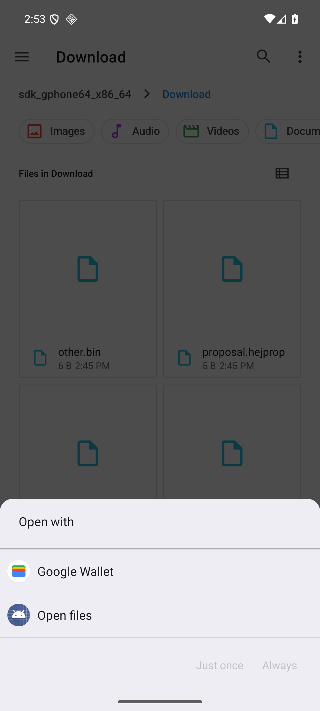
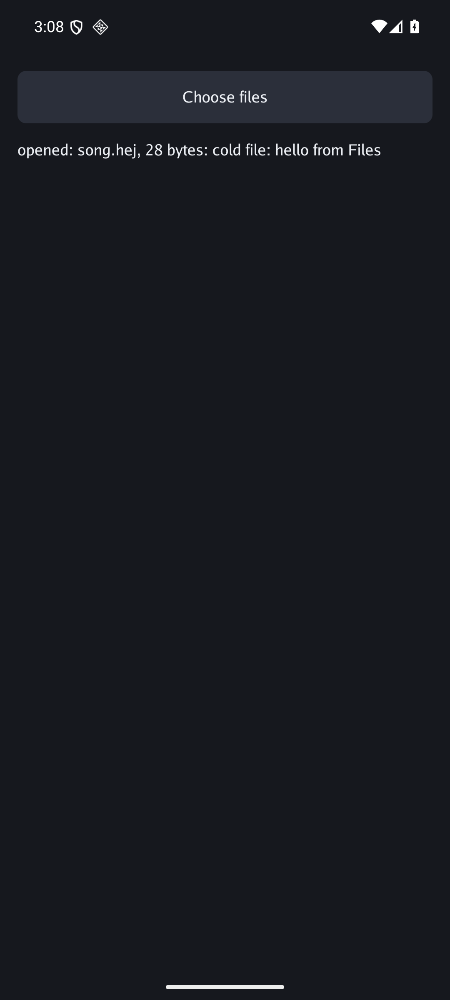
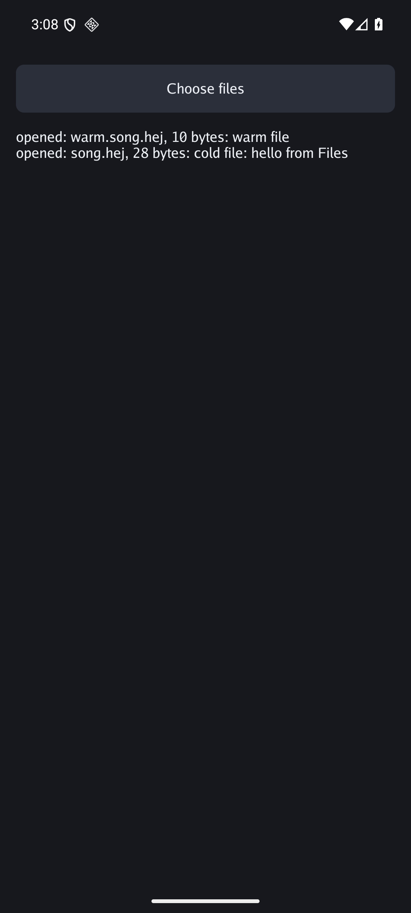

# C1 on the emulator, 2026-11-04

Android 16 AVD `gunim`, read-only copy, x86_64, 1080x2400, software GPU. Commit 3717411a87b632f56ed83051c3006581cfb0a888, `example/openfiles`, built with `-opens .hej,.hejprop`.

## Cold: pass

The app was stopped. Files, Download, song.hej, Open files, Just once. The app started and showed the file.

## Warm: pass

With the app running, Files, Download, warm.song.hej, Open files, Just once. The same process took it, and the list holds both.

